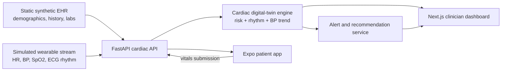

# CardioTwin architecture

## Runtime flow

1. The API seeds synthetic EHR profiles and baseline wearable readings.
2. The dashboard and mobile app request the patient profile and recent telemetry.
3. The prediction endpoint combines static EHR factors with recent vital signs.
4. Threshold checks generate cardiac, arrhythmia, and hypertension alerts.
5. Clinicians acknowledge alerts from the dashboard; the mobile app displays the patient-facing status.

## Data boundary

This proof-of-concept uses synthetic data only. No real patient records, credentials, or production database are included in the repository.
